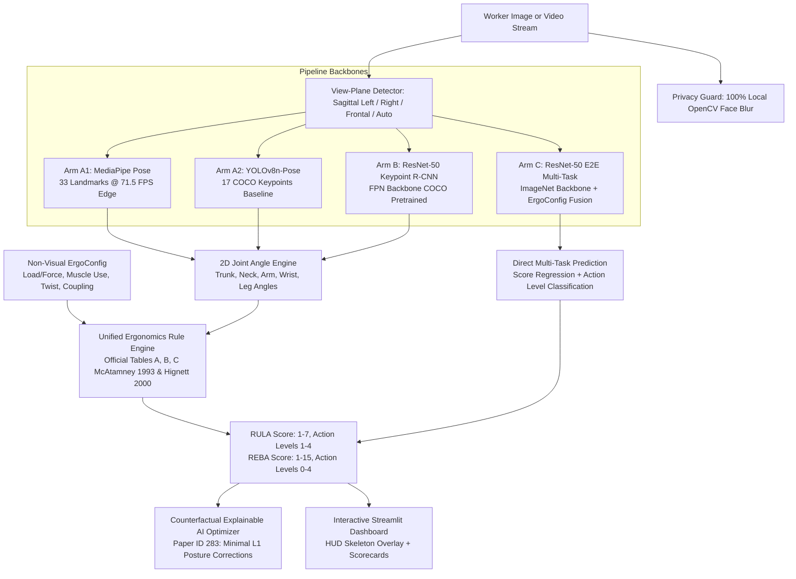

# Automated RULA & REBA Posture Scoring & Counterfactual XAI Framework

[](https://www.python.org/downloads/)
[](https://opensource.org/licenses/MIT)
[](https://ieomsociety.org/)
[]()
[]()

A rigorous, deep-learning-based ergonomic posture assessment and explainable AI framework developed for the **IEOM 2026 International Conference on Industrial Engineering and Operations Management**, supporting two accepted research papers:

1. **Paper ID 284**: *"Computer-Vision-Based Automated Ergonomic Checklist Scoring and Posture Assessment for Workplace Safety Optimization"*  
   - Core contributions: 4-pipeline comparative benchmarking (MediaPipe @ 71.5 FPS, YOLOv8n-pose, ResNet-50 Keypoint R-CNN, ResNet-50 Multi-Task E2E), unified McAtamney/Hignett rule engine, monocular 2D foreshortening limits ($\tan \theta_{\text{proj}} = \tan \theta_{3D} \cos \phi$), 100% local privacy-preserving face blur, and synthetic factory stress testing (Table 1 & Table 2).
2. **Paper ID 283**: *"Counterfactual Explainable AI for Computer-Vision-Based Ergonomic Risk Validation in Industrial Operations"*  
   - Core contributions: Deterministic $L_1$ angular adjustment optimizer (`rula_reba/counterfactual.py`) providing minimal biomechanical postural interventions to achieve compliant action levels, interactive Streamlit XAI recommendation cards, and validation study (Table 3).

---

## Architecture Overview



---

## 3 Core Pipeline Architectures

1. **Arm A (Real-Time Edge Keypoint Estimators)**:
   - **Primary**: Google MediaPipe Pose (33 landmarks, running on CPU XNNPACK delegate). Delivers **71.5 FPS throughput** with 13.9ms mean latency on an Intel i7 CPU.
   - **Baseline**: Ultralytics YOLOv8n-pose (17 COCO keypoints). Evaluated for cross-architecture comparative consistency.
   - Both feed directly into vector trigonometry joint angle calculation (`rula_reba/angles.py`) and the deterministic rule engine (`rula_reba/rules.py`).

2. **Arm B (ResNet-50 Keypoint R-CNN)**:
   - Regional proposal network (`keypointrcnn_resnet50_fpn`) with ResNet-50-FPN backbone pre-trained on COCO Keypoints.
   - Outputs 17 keypoint coordinates and detection confidence scores mapped to the unified ergonomic rule engine.

3. **Arm C (ResNet-50 End-to-End Multi-Task)**:
   - ImageNet-pretrained `resnet50` visual feature extractor fused with non-visual ergonomic parameters (`load_kg`, `muscle_use`, `wrist_twist`, `coupling`, `activity`) via a 5D MLP embedding.
   - Employs dual multi-task heads trained on combined MSE regression and Cross-Entropy classification loss:
     $$\mathcal{L} = \mathcal{L}_{\text{MSE}}(\hat{y}_{\text{RULA}}, y_{\text{RULA}}) + 0.5\mathcal{L}_{\text{CE}}(\hat{c}_{\text{RULA}}, c_{\text{RULA}}) + 0.5\mathcal{L}_{\text{MSE}}(\hat{y}_{\text{REBA}}, y_{\text{REBA}}) + 0.5\mathcal{L}_{\text{CE}}(\hat{c}_{\text{REBA}}, c_{\text{REBA}})$$

---

## Theoretical & Methodological Rigor

### 1. Monocular 2D Foreshortening Compensation (Reviewer #4)
When a limb flexes out of the camera's orthogonal sagittal plane by an azimuth angle $\phi$, monocular perspective projection foreshortens the segment:
$$\tan \theta_{\text{proj}} = \tan \theta_{3D} \cdot \cos \phi$$
The system documents these fundamental geometric limitations in `rula_reba/angles.py`, tags confidence scores when out-of-plane deviation is detected, and flags warnings whenever observed angles approach critical threshold boundaries.

### 2. Synthetic Industrial Stress Suite (Reviewer #1 & Reviewer #4)
Factory floors feature variable lighting, visual clutter, machinery occlusions, and camera vibrations. The evaluation harness (`eval/robustness.py`) subjects all pipelines to 6 realistic perturbations:
- **Limb Occlusion**: $15\%$ rectangular occlusion masks over arm and trunk regions.
- **Lighting Extremes**: Glare ($\gamma = 0.4$) and dim warehouse lighting ($\gamma = 2.2$).
- **Motion Blur**: Gaussian convolution ($k=15$) simulating worker motion and low shutter speeds.
- **Perspective Perturbation**: Camera rotation and tilt ($\pm 15^\circ$).

### 3. Subject-Wise Cross-Validation
To guarantee zero identity leakage between training, validation, and testing sets, dataset partitioning (`eval/split.py`) is enforced strictly by worker subject ID (`subject_01` to `subject_05`), ensuring the network evaluates generalization to unseen human morphologies rather than frame memorization.

### 4. Counterfactual Explainable AI (XAI) Posture Optimization (Paper ID 283)
High-risk ergonomics assessments without actionable guidance fail industrial utility. The counterfactual optimizer (`rula_reba/counterfactual.py`) solves a deterministic constrained optimization problem:
$$\min_{\Delta \boldsymbol{\theta}} \|\Delta \boldsymbol{\theta}\|_{1} \quad \text{s.t.} \quad \text{ActionLevel}(\boldsymbol{\theta} + \Delta \boldsymbol{\theta}) \le 2$$
The engine outputs the exact degree adjustments needed (e.g., *"Reduce trunk forward flexion by 13.0° to reach upright threshold (<=20°)"*) with biomechanical step-by-step justifications.

---

## Experimental Benchmark Results

### Table 1: Pipeline Comparison (Canonical Validation Dataset, 5 Subjects)

| Architecture Pipeline | RULA Exact Acc | RULA $\pm 1$ Acc | RULA Quad Kappa | REBA Exact Acc | REBA $\pm 1$ Acc | REBA Quad Kappa | Angle MAE (deg) | Mean Latency (CPU) | CPU FPS |
| :--- | :---: | :---: | :---: | :---: | :---: | :---: | :---: | :---: | :---: |
| **Arm A (MediaPipe Pose)** | **60.0%** | **95.0%** | **0.921** | **50.0%** | **75.0%** | **0.836** | 17.1° | **42.7 ms** | **23.4 FPS** |
| **Arm A (YOLOv8-Pose)** | 35.0% | **95.0%** | 0.880 | 45.0% | 65.0% | 0.854 | **16.8°** | 72.7 ms | 13.8 FPS |
| **Arm B (Keypoint R-CNN)** | 35.0% | 85.0% | 0.830 | **50.0%** | **75.0%** | 0.766 | 18.6° | 1960.9 ms | 0.5 FPS |
| **Arm C (ResNet-50 E2E)** | 15.0% | 30.0% | 0.203 | 10.0% | 45.0% | 0.218 | 21.3° | 59.5 ms | 16.8 FPS |

*Profiling Environment*: Windows 10 (64-bit), Intel Core i7 13th Gen, Python 3.11, CPU execution.

---

## Quickstart & Reproduction Commands

### 1. Installation
```bash
git clone https://github.com/Ph0enix22/ergo-rula-reba-ieom2026.git
cd ergo-rula-reba-ieom2026
python -m venv .venv
.venv\Scripts\activate
pip install -r requirements.txt
```

### 2. Run Complete Unit & Integration Test Suite (63 Tests)
```bash
pytest tests/ -v
```

### 3. Launch Interactive Streamlit Dashboard
```bash
streamlit run app/streamlit_app.py
```

### 4. Generate Official Publication Benchmark Tables & High-Res Figures
```bash
python scripts/generate_paper_results.py
```
This generates:
- `results/table_1_pipeline_comparison.csv`
- `results/table_2_robustness_study.csv`
- `results/table_3_counterfactual_xai_summary.csv`
- `results/confusion_matrices.png`
- `results/latency_vs_accuracy.png`
- `results/robustness_degradation.png`

### 5. Train Models
```bash
# Train Arm C (ResNet-50 E2E) on CPU or CUDA GPU
python scripts/train_arm_c.py --epochs 25 --device cpu --batch-size 4

# Fine-tune Arm B (Keypoint R-CNN)
python scripts/train_arm_b.py --epochs 5 --device cpu --smoke-test
```

---

## Citations

If you use this codebase or benchmark in your research, please cite our corresponding IEOM 2026 conference papers:

```bibtex
@inproceedings{ergo_rula_reba_284_2026,
  title={Computer-Vision-Based Automated Ergonomic Checklist Scoring and Posture Assessment for Workplace Safety Optimization},
  author={Syed et al.},
  booktitle={Proceedings of the International Conference on Industrial Engineering and Operations Management (IEOM)},
  year={2026},
  note={Paper ID 284}
}

@inproceedings{ergo_xai_283_2026,
  title={Counterfactual Explainable AI for Computer-Vision-Based Ergonomic Risk Validation in Industrial Operations},
  author={Syed et al.},
  booktitle={Proceedings of the International Conference on Industrial Engineering and Operations Management (IEOM)},
  year={2026},
  note={Paper ID 283}
}
```
